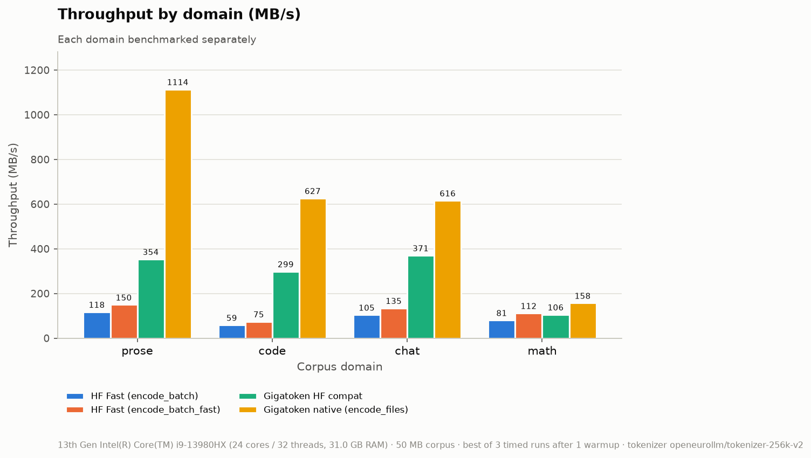

# gigatoken-eurollm-poc

[](https://github.com/joenaess/gigatoken-eurollm-poc/actions/workflows/ci.yml)

Does [`gigatoken`](https://pypi.org/project/gigatoken/) tokenize
**[`openeurollm/tokenizer-256k-v2`](https://huggingface.co/openeurollm/tokenizer-256k-v2)**
faster than Hugging Face [`tokenizers`](https://github.com/huggingface/tokenizers), and does it
produce **exactly the same token IDs**?

**Answer: yes on both counts.** gigatoken is **2.7–9× faster** and gave **identical token IDs in every test**.
All numbers below were measured with this tokenizer, on the same text and the same machine.

## Result

|                          | Without gigatoken<br>(HF `tokenizers`) | With gigatoken<br>(drop-in, `.as_hf()`) | With gigatoken<br>(native API) |
|--------------------------|---------:|---------:|---------:|
| Throughput (50 MB text)  | 112 MB/s | 302 MB/s | 1,004 MB/s |
| Speedup                  | 1×       | **2.7×** | **9.0×** |
| Throughput, 1 CPU core¹  | 7.4 MB/s | –        | 160.7 MB/s (22×) |
| Token IDs                | reference | identical | identical |

¹ Measured on a 10 MB subset with `RAYON_NUM_THREADS=1`.


Speedup by text type. The gain is biggest on indented code and smallest on digit-heavy math:

| | prose | code | chat | math |
|---|---:|---:|---:|---:|
| gigatoken drop-in | 3.0× | 5.1× | 3.5× | 1.3× |
| gigatoken native | 9.5× | 10.6× | 5.9× | 2.0× |



Full numbers: [`results/benchmark_summary.md`](results/benchmark_summary.md). Raw data is in
[`results/benchmark_results.json`](results/benchmark_results.json), and the remaining charts are
in [`results/`](results/).

## Correctness

The same text was encoded by five implementations of the tokenizer, and each case required all
five lists of token IDs to be equal:

- Hugging Face `AutoTokenizer`
- Hugging Face `tokenizers`
- Google `sentencepiece` (the original `tokenizer.model`)
- gigatoken drop-in
- gigatoken native

**609 test cases. gigatoken never differed from Hugging Face.** The cases cover:
- all 176 special/added tokens, including ChatML, `<think>`, FIM and StarCoder markers
- indentation and whitespace runs
- the Georgian, Greek, Bulgarian and Ukrainian scripts, plus Latin
- emoji, rare characters and Unicode normalisation forms
- whole documents from every text type

During the benchmark, all engines also produced the same token count (10,346,407).

The 4 cases marked "expected failure" are not gigatoken issues. Raw `sentencepiece` does not
recognise `<unk>`, `<bos>`, `<eos>` and `<pad>` when they appear as plain text, whereas Hugging
Face and gigatoken agree with each other on them. Details are in
[`results/parity_report.md`](results/parity_report.md).

## Why it is faster

- **Each CPU core does more work.** With one core, gigatoken is 22× faster than Hugging Face, so
  the gain is not just from using more threads.
- **Native vs drop-in.** Both encode at about 1 GB/s. The drop-in mode is slower only because it
  must return Python lists, and building about 10 million Python integers costs more than the
  tokenization itself. Asking it for NumPy output (`return_tensors="np"`) avoids most of that
  cost.

## Should we use it?

- ✅ **Bulk tokenization of training data:** use the native API (`encode_files` / `encode_batch`) for about 9×.
- ✅ **Existing code that only needs `input_ids`:** swap in `gt.Tokenizer(hf_tok).as_hf()` for about 2.7×.
- ❌ **Code that needs character offsets** (NER, QA spans): `return_offsets_mapping=True` is
  **silently ignored**. Sequence pairs and pre-split input are not supported.
- ⚠️ **gigatoken is pre-1.0 (0.10.0):** pin the version and re-run this parity suite before upgrading.

## Run it yourself

```bash
uv sync
uv run pytest                                            # unit + parity tests
uv run python scripts/run_benchmark.py --size-mb 50      # writes results/
```

## Notes

- **Setup.** Intel i9-13980HX (24 cores / 32 threads), Python 3.12, gigatoken 0.10.0,
  tokenizers 0.23.3. Each number is the best of 3 timed runs after 1 warmup. The 50 MB test text
  is synthetic: 70% multilingual prose, 15% code, 10% chat, 5% math.
- **Calls compared.**
  - Hugging Face: `Tokenizer.encode_batch`.
  - gigatoken drop-in: `.as_hf()(texts)`. The `HFCompat` wrapper has **no `encode_batch`**,
    despite gigatoken's README.
  - gigatoken native: `encode_files(TextFileSource(...))`.
- **Faster Hugging Face variant.** Hugging Face's `encode_batch_fast` (no offsets) reaches
  132 MB/s. gigatoken native is still 7.6× faster than that.
- **Vocabulary counts.** The release notes' "45 whitespace tokens" includes 32 pieces that can
  never be produced, because spaces become `▁` before lookup. The special-token count is 176,
  not 204. See [`results/parity_report.md`](results/parity_report.md).

License: [MIT](LICENSE)
