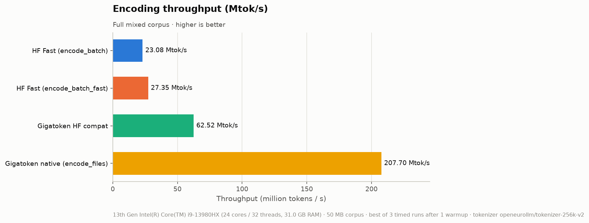

# gigatoken-eurollm-poc

[](https://github.com/joenaess/gigatoken-eurollm-poc/actions/workflows/ci.yml)

A token-ID parity and throughput benchmark comparing **Hugging Face [`tokenizers`](https://github.com/huggingface/tokenizers)**
with **[`gigatoken`](https://pypi.org/project/gigatoken/)** on the
**[`openeurollm/tokenizer-256k-v2`](https://huggingface.co/openeurollm/tokenizer-256k-v2)**
SentencePiece-BPE tokenizer (262,144 pieces, byte fallback).

## Why

Tokenizing pretraining corpora is a recurring cost, so a faster tokenizer is only useful if it
produces **exactly** the same token IDs. This PoC checks both:

1. **Correctness.** Token IDs must be identical across five encoding paths (HF `AutoTokenizer`,
   raw `tokenizers`, raw `sentencepiece`, gigatoken's HF-compatible wrapper and gigatoken's
   native API). The checks cover the edge cases introduced in v2: whitespace and indentation tokens,
   ChatML/reasoning/FIM/StarCoder markers, and the Georgian, Greek, Bulgarian and Ukrainian script fixes.
2. **Performance.** Encoding throughput (MB/s and Mtok/s) on a synthetic corpus that follows
   the training mix (prose, deeply indented code, chat with `<think>` blocks, math).

## Quick start

Requires [`uv`](https://docs.astral.sh/uv/).

```bash
uv sync                                   # create .venv and install everything

uv run pytest tests/unit                  # fast unit tests (no network)
uv run pytest -m parity                   # parity suite (downloads the tokenizer, ~10 s)
uv run pytest                             # everything; also writes results/parity_report.md

uv run python scripts/run_benchmark.py --size-mb 50 --output-dir results/
```

Benchmark options: `--size-mb` (default 50), `--iterations` (timed runs, default 3),
`--warmup` (default 1), `--output-dir` (default `results/`), `--output-markdown PATH` (an extra
copy of the summary table), `--seed`, `--data-dir` (generated corpus, gitignored) and
`--no-extra-baseline`.

Quality gate (also run in CI, minus the parity suite):

```bash
uv run ruff check . && uv run ruff format --check . && uv run pytest
```

## Results

50 MB mixed corpus, 23,908 documents and 10,346,407 tokens. Each figure is the best of 3 timed runs
after 1 warmup run, on an Intel i9-13980HX (24 cores / 32 threads). Full numbers are in
[`results/benchmark_results.json`](results/benchmark_results.json) and
[`results/benchmark_summary.md`](results/benchmark_summary.md).

### Overall

| Engine                          | Best (s)   | Mean ± std (s)   | MB/s   | Mtok/s   | Speedup   |
|---------------------------------|------------|------------------|--------|----------|-----------|
| HF Fast (encode_batch)          | 0.448      | 0.456 ± 0.008    | 111.6  | 23.08    | 1.00×     |
| HF Fast (encode_batch_fast)     | 0.378      | 0.386 ± 0.007    | 132.2  | 27.35    | 1.19×     |
| Gigatoken HF compat             | 0.165      | 0.171 ± 0.008    | 302.2  | 62.52    | 2.71×     |
| Gigatoken native (encode_files) | 0.050      | 0.052 ± 0.002    | 1003.9 | 207.70   | 9.00×     |

Speedup is the best-time ratio relative to **HF Fast (`encode_batch`)**.
`encode_batch_fast` (same library, but no offset tracking) is a supplementary, stronger
baseline.

### Per domain: MB/s (speedup)

| Engine                          | prose          | code           | chat          | math          |
|---------------------------------|----------------|----------------|---------------|---------------|
| HF Fast (encode_batch)          | 117.8 (1.00×)  | 59.1 (1.00×)   | 104.6 (1.00×) | 80.8 (1.00×)  |
| HF Fast (encode_batch_fast)     | 150.1 (1.27×)  | 74.7 (1.26×)   | 135.0 (1.29×) | 112.2 (1.39×) |
| Gigatoken HF compat             | 354.1 (3.01×)  | 299.0 (5.06×)  | 370.6 (3.54×) | 105.9 (1.31×) |
| Gigatoken native (encode_files) | 1114.3 (9.46×) | 626.9 (10.61×) | 616.3 (5.89×) | 157.7 (1.95×) |





**Takeaways**

- gigatoken's native file API reaches about **1 GB/s** on this machine, **9×** faster than
  `tokenizers.encode_batch`. As a drop-in replacement behind the transformers API, it is
  still **2.7×** faster.
- The advantage is largest on **code**, the domain with deep indentation (5× for compat, 10.6× for native).
  HF's throughput halves on code compared with prose, while gigatoken's compat path drops only about 15%.
- The gap is smallest on **math**: about 2 bytes per token (digits are split individually),
  and the payload is small (2.5 MB, about 16–30 ms per pass). Per-token and per-call overheads
  dominate there, and on this domain the compat path is slightly slower than HF `encode_batch_fast`.

## Parity results

**Status: PASS.** No mismatch on any case across all five encoding paths. See
[`results/parity_report.md`](results/parity_report.md).

| Category   | Cases | Passed | Failed | Expected fail (strict) |
|------------|------:|-------:|-------:|-----------------------:|
| whitespace |   181 |    181 |      0 |                      0 |
| specials   |   376 |    372 |      0 |                      4 |
| scripts    |    52 |     52 |      0 |                      0 |
| **total**  |   609 |    605 |      0 |                      4 |

Every parity case asserts `hf_auto == hf_raw == sp == gt_compat == gt_native`. The cases are
generated from the tokenizer's own vocabulary:

- **whitespace**: indentation of 2, 3, 4, 8, 16 and 32 spaces, tab ladders, `\t\n`, `\r\n`, lone `\r`,
  and `\n`×2…7. Every whitespace-only added token and BPE piece is tested alone and in
  context. Each whitespace added token must encode to exactly its own ID on every path.
- **specials**: every one of the 176 `added_tokens`, alone and in context, plus scenarios:
  multi-turn ChatML with `<think>`, FIM (prefix/suffix/middle), `<fim_pad>` runs, StarCoder
  repo layouts, Jupyter markers, glued and partial markers, and markers next to whitespace tokens.
- **scripts**: Georgian (Mkhedruli, Nuskhuri, Asomtavruli, Mtavruli), Greek (incl.
  polytonic), Bulgarian (incl. Old Bulgarian letters), Ukrainian (ґ є ї, apostrophes), Latin
  diacritics, byte-fallback cases (emoji ZWJ sequences, CJK Ext-B, Glagolitic, combining
  stacks, control/PUA characters), NFC/NFD/NFKC/NFKD variants, and full corpus documents from
  every domain encoded with each engine's batch API.

The **4 strict expected failures** are `<unk>`, `<bos>`, `<eos>` and `<pad>` written as plain
text. Raw SentencePiece never matches CONTROL/UNKNOWN pieces in input text (they can only be
inserted as IDs), so it tokenizes them as characters. HF and both gigatoken paths map them to
IDs 0–3, and separate passing tests assert that those four paths agree. The `xfail` is `strict`,
so the suite fails if that behaviour ever changes.

### Token counts vs. the v2 release notes

The release notes quote ~45 whitespace tokens and ~204 user-defined/special tokens. Counted
from `tokenizer.json` and `tokenizer.model` ([`src/poc/vocab.py`](src/poc/vocab.py)):

| Quantity                                   | Derived | Release notes |
|--------------------------------------------|--------:|--------------:|
| `added_tokens` entries                     |     176 |          ~204 |
| ↳ flagged `special: true`                  |     163 |               |
| SentencePiece USER_DEFINED / CONTROL       | 172 / 3 |               |
| Whitespace-only added tokens               |      13 |               |
| Whitespace-only BPE pieces                 |      51 |               |
| Added + literal-space pieces               |  **45** |       **~45** |
| Whitespace tokens reachable from text      |      32 |               |

- **Special tokens: 176 / 163 ≠ 204.** This includes 128 `<unused_N>` placeholders. I could not
  reproduce 204 from the published files.
- **Whitespace: 45 matches, but 32 of those 45 are unreachable.** The 45 are the 13 whitespace
  added tokens (`\t`×1–8, `\n\n`, `\n\n\n`, `\n\n\n\n`, `\r\n`, `\t\n`) plus 32 pieces spelled
  with literal U+0020 spaces (2–32 spaces, and `"    \n"`). The tokenizer has no normalizer and
  uses `Metaspace`, and SentencePiece escapes whitespace the same way. So every space becomes
  `▁` *before* BPE, and indentation is encoded with the separate `▁`-run pieces (up to 16 `▁`).
  `test_literal_space_pieces_are_never_emitted` confirms that no path ever emits the
  literal-space pieces. All engines agree, so this is a property of the tokenizer, not a
  parity issue, but it may not be what the v2 changes intended.

## Conclusion

### Speed

On this tokenizer, gigatoken is **9× faster** than `tokenizers.encode_batch` through its native
API (about 1 GB/s) and **2.7× faster** as a drop-in replacement behind the transformers API. The
speedup holds in every domain: it is largest on indented code (10.6×) and smallest on
digit-heavy math (2×). These numbers are consistent with gigatoken's own published benchmarks, which put
SentencePiece-BPE tokenizers (Gemma, Mistral, Llama 2) at roughly 7–21× over HF, and describe
that tokenizer family as "not well optimized in Gigatoken" compared with byte-level BPE
tokenizers, where it reports 100–1000×.

### Where the speed comes from

I measured three effects in this repo, on the same 50 MB corpus unless noted:

| Observation | Measurement | What it shows |
|---|---|---|
| **Per-core efficiency** | Single thread (`RAYON_NUM_THREADS=1`, 10.5 MB subset): gigatoken 160.7 MB/s vs HF 7.4 MB/s, about **22×** | Most of the gain is in the encoder itself, not in using more threads. HF needs 32 threads (98.5 MB/s) to come within 2× of gigatoken on one. |
| **Input path barely matters** | Native `encode_files` (file) 1013 MB/s, `encode_batch(BytesSource)` 1054 MB/s, `encode_batch(list[str])` 1032 MB/s | The native-API speed is also available for in-memory data. File reading is not the bottleneck. |
| **Python output dominates the compat path** | Native output (awkward `uint32`) about 1030 MB/s, vs. the same encoder returning `list[list[int]]` (`encode_batch_list`) 298 MB/s, compat `__call__` 298 MB/s, and compat with `attention_mask` 263 MB/s | The drop from 9× to 2.7× is almost entirely the cost of creating about 10M Python `int` objects. Compat adds no measurable overhead beyond that, and attention masks cost about 12% more. |

For the internals, gigatoken's author attributes the speed to SIMD pretokenization that replaces
the regex engine, aggressive caching of pretoken→token mappings, minimal Python interaction, and
avoiding cross-thread communication. I did not profile the Rust internals to confirm this. One
inference worth noting: this tokenizer's pretokenizer is a non-splitting `Metaspace` with no
regex. So the regex-replacement gain the author emphasises probably contributes little here,
which would explain why SentencePiece models see smaller speedups than byte-level BPE ones.

### Correctness

Across the 605 asserted cases plus every document of a multi-domain corpus sample, I found
**no token-ID difference** between gigatoken (compat or native) and Hugging Face. Coverage
includes all 176 added tokens, whitespace and indentation runs, ChatML/FIM/StarCoder markers,
the v2 scripts, byte fallback and Unicode normalisation variants. The only divergence in the
suite is raw SentencePiece treating `<unk>`/`<bos>`/`<eos>`/`<pad>` as plain text, which is
documented SentencePiece behaviour, not a gigatoken issue. This is strong evidence of parity
for this tokenizer and gigatoken version, not a proof. The cases are synthetic or hand-written,
and the result says nothing about other tokenizers or future releases.

### Should you use it?

**Yes, for bulk preprocessing.** Tokenizing pretraining corpora into token shards is the ideal
case. Use the native API (`encode_files` or `encode_batch`) and keep the awkward/NumPy output
instead of converting to Python lists. You get about 9× more throughput on a laptop CPU with
identical IDs, and the gain grows with core count.

**Yes, as a drop-in where tokenization is a bottleneck.** `gt.Tokenizer(hf_tok).as_hf()` is a
one-line change for code that calls the tokenizer on batches and only needs `input_ids` and
`attention_mask`. That gives about 2.7× here, and `return_tensors="np"`/`"pt"` avoids most of the list
overhead.

**No, or not yet, when:**

- **You need offsets.** `return_offsets_mapping=True` is **silently ignored**: there is no
  `offset_mapping` key and no error, although the class docstring says unsupported options
  raise. Token/character alignment code (NER, QA span extraction) would break silently. Keep
  HF for these pipelines.
- **You use sequence pairs or pre-tokenized input** (`text_pair`, `is_split_into_words`). Both
  raise `ValueError`/`NotImplementedError`. Truncation also requires an explicit `max_length`.
- **You depend on HF `Encoding` objects** (word IDs, offsets, overflow), or call
  `encode_batch` on the compat object. That method doesn't exist, even though gigatoken's own
  README shows it.
- **Tokenization is not your bottleneck.** HF already processes 50 MB in 0.45 s here. For
  fine-tuning sets or online serving of single requests, the gain may not justify a new
  dependency. Single-request latency was not measured.
- **You can't pin and re-verify.** gigatoken is pre-1.0 (0.10.0), and its README and API already
  differ. If you adopt it, pin the version and run a parity suite like this repo's as a gate
  on every upgrade.

**Recommendation for OpenEuroLLM:** use gigatoken's native API for corpus tokenization with a
pinned version and this parity suite in CI. Use the compat wrapper in `input_ids`-only data
loaders. Keep Hugging Face `tokenizers` wherever offsets, pairs or `Encoding` objects are needed.

## Environment

| | |
|---|---|
| CPU | 13th Gen Intel Core i9-13980HX, 24 cores / 32 threads |
| RAM | 31 GB |
| OS | Linux 7.1.5 x86_64 (glibc 2.39) |
| Python | 3.12.3 |
| gigatoken | 0.10.0 |
| tokenizers | 0.23.3 |
| transformers | 5.19.0 |
| sentencepiece | 0.2.2 |

All engines used their default thread pools (all 32 logical threads, with no
`RAYON_NUM_THREADS` / `TOKENIZERS_PARALLELISM` overrides). The run timestamp and environment
are recorded in `benchmark_results.json`.

## Methodology

**Corpus** ([`src/poc/corpus.py`](src/poc/corpus.py)). The corpus is a deterministic synthetic
generator (seeded, with no external data), measured in UTF-8 bytes:

| Domain | Share | Content |
|---|---:|---|
| prose | 70% | English (30% of prose) plus de, fr, sv, es, pl, fi, ka, el, bg, uk; paragraphs separated by `\n`, `\n\n` or `\r\n\r\n` |
| code | 15% | Python classes with nesting up to 8 levels (4-space, 2-space or tab indentation), plus nested JSON at indent 2/4/8 |
| chat | 10% | ChatML multi-turn conversations with `<think>…</think>` reasoning blocks |
| math | 5% | LaTeX equations, arithmetic, and FIM and StarCoder markers |

Documents are written as `<|endoftext|>\n`-separated text (one file overall plus one per domain) and as
JSONL with a `domain` field. `<|endoftext|>` is *not* in this vocabulary, which is fine, because it
is only used as a file-level separator and never reaches the tokenizer.

**Engines** ([`src/poc/bench.py`](src/poc/bench.py)). All engines run without BOS/EOS
(`add_special_tokens=False`):

| Engine | Call |
|---|---|
| HF Fast (baseline) | `tokenizers.Tokenizer.from_file(...).encode_batch(texts)` |
| HF Fast, no offsets (supplementary) | `...encode_batch_fast(texts)` |
| Gigatoken HF compat | `gt.Tokenizer(AutoTokenizer.from_pretrained(...)).as_hf()(texts, return_attention_mask=False)` |
| Gigatoken native | `gt.Tokenizer("openeurollm/tokenizer-256k-v2").encode_files(gt.TextFileSource([path], separator="<\|endoftext\|>\n"))` |

**Timing.**

- Each (engine, payload) pair gets 1 untimed warmup pass, then N = 3 timed passes.
- Each timed pass wraps only the encode call in `time.perf_counter()`. GC is collected beforehand and disabled during the call.
- Token counting and result disposal happen outside the timed region.
- The reported time is the **minimum**; mean and std are also recorded.
- MB/s uses 1 MB = 10⁶ bytes of UTF-8 document text (separators excluded), and Mtok/s uses the
  engine's token count.
- The overall corpus and each domain are separate payloads.

**Cross-checks.** After timing, the harness verifies that every engine produced the same total
token count for each payload. It aborts if they differ, and they never did. Per-document ID
equality is covered by the parity suite.

## Known limitations

- **Native path includes I/O; the others don't.** `encode_files` reads and splits the file
  inside the timed call (from the page cache after warmup). HF and compat get a pre-split
  `list[str]`. This favours the in-memory engines slightly.
- **Different output types.** HF returns `Encoding` objects (with offsets, masks and so on), compat returns
  `list[list[int]]`, and native returns an awkward array of `uint32`. The engines do different
  amounts of work, which is part of what is being compared. `encode_batch_fast` is included to
  show how much of HF's gap is offset tracking (about 16–28%).
- **Synthetic text.** Prose is sampled from small per-language word lists, so the vocabulary is
  less diverse than real web text. Absolute throughput on real data will differ, though the
  relative ordering is likely to hold.
- **Small per-domain payloads.** Math (2.5 MB) and chat (5 MB) passes take about 8–50 ms, so fixed
  per-call overheads and timer noise matter more there than in the 50 MB overall run.
- **Single machine, single run.** One laptop-class CPU (hybrid P/E cores) and no CPU pinning.
- **Parity tests need network** on first run (the tokenizer is downloaded from the Hub and
  then cached). CI only runs lint and unit tests.

## Differences between the documented and actual gigatoken API

These were checked against the installed `gigatoken` 0.10.0 source.

| Spec assumption | Actual API | What this repo does |
|---|---|---|
| `gt.Tokenizer(hf_tok).as_hf().encode_batch(...)` (also shown in gigatoken's own README) | `HFCompat` mirrors the transformers tokenizer API and **has no `encode_batch`** (`AttributeError`). Batches go through `__call__(list[str])` | `compat(texts, add_special_tokens=False, return_attention_mask=False)["input_ids"]` |
| Drop-in for the transformers `__call__` | `return_offsets_mapping=True` is **silently ignored** (no `offset_mapping` key). Sequence pairs and `is_split_into_words` raise | Only `input_ids` are used here. See [Should you use it?](#should-you-use-it) |
| `gt.Tokenizer("openeurollm/tokenizer-256k-v2")` | Works as documented: downloads `tokenizer.json` directly and picks the `SentencePieceBPE` backend | Used as-is |
| `encode_files(gt.TextFileSource(...))` | `TextFileSource(paths: list, separator: str \| bytes \| None)`. Without a separator, each file is one document | Pass a list of paths and the `<\|endoftext\|>\n` separator |
| `gt.JsonlFileSource(...)` | `JsonlFileSource(paths: list, field="text")` | JSONL is exported but not benchmarked (the text path is used) |
| Return types | `encode_batch` / `encode_files` return an `awkward.Array` of `uint32`. `encode_batch_list` returns `list[list[int]]` | Tokens counted with `ak.num` |

Other notes: `gigatoken.Tokenizer.from_sentencepiece(path)` can load the raw `.model` without the
`sentencepiece` package. `parallel=None` auto-disables threading inside multiprocessing
workers.

## Project layout

```text
src/poc/corpus.py      synthetic multi-domain corpus (text / JSONL export)
src/poc/bench.py       engines, timing harness, environment capture
src/poc/vocab.py       token inventories derived from tokenizer.json / tokenizer.model
src/poc/reporter.py    JSON + Markdown summary + parity report
src/poc/plots.py       matplotlib (Agg) graphs
scripts/run_benchmark.py
tests/unit/            fast, offline tests (CI)
tests/parity/          real-tokenizer parity suite (@pytest.mark.parity)
results/               committed benchmark outputs
```

## License

[MIT](LICENSE)
